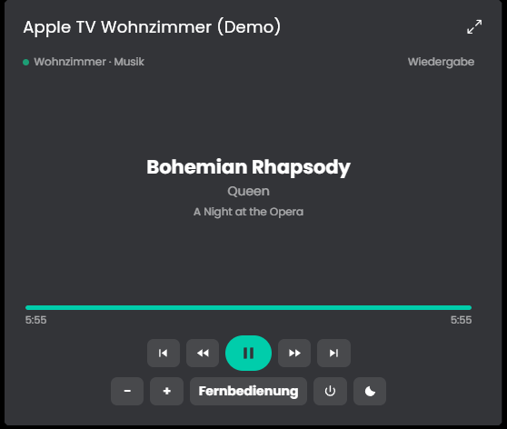
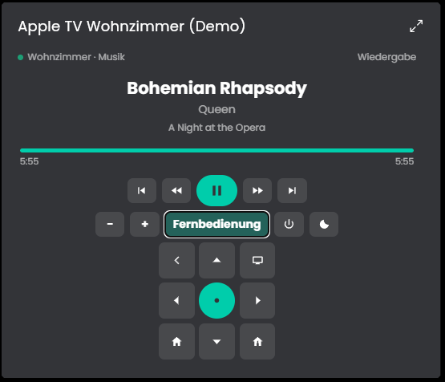

# AppleTV
Mit diesem Modul lässt sich ein Apple TV über die pyatv-mqtt-bridge per MQTT in IP-Symcon einbinden. Es zeigt die aktuelle Wiedergabe, steuert das Gerät und bringt eine Kachel mit Player und Fernbedienung für die Kachel-Visualisierung mit.

## Inhaltsverzeichnis
- [AppleTV](#appletv)
  - [Inhaltsverzeichnis](#inhaltsverzeichnis)
  - [Screenshots](#screenshots)
  - [1. Voraussetzungen](#1-voraussetzungen)
  - [2. Funktionsumfang](#2-funktionsumfang)
  - [3. Enthaltene Module](#3-enthaltene-module)
  - [4. Installation](#4-installation)
  - [5. Konfiguration in IP-Symcon](#5-konfiguration-in-ip-symcon)
  - [6. Spenden](#6-spenden)
  - [7. Lizenz](#7-lizenz)

## Screenshots

## 1. Voraussetzungen

* mindestens IPS Version 9.0
* [pyatv-mqtt-bridge](https://github.com/sebbo2002/pyatv-mqtt-bridge), die den Apple TV über MQTT bereitstellt (Einrichtung siehe dortige Anleitung)
* ein MQTT-Server oder ein externer MQTT-Broker, mit dem die Bridge verbunden ist
* Am Apple TV muss unter Einstellungen, AirPlay und HomeKit der Zugriff "Für jeden im selben Netzwerk" ausgewählt sein.

Vielen Dank an [sebbo2002](https://github.com/sebbo2002) für die Bereitstellung der pyatv-mqtt-bridge.

## 2. Funktionsumfang

* Anzeige der aktuellen Wiedergabe und der laufenden App
* Anzeige von Gerätename, IP-Adresse, Gerätestatus und Power-Status
* Steuerung des Apple TV (Navigation, Wiedergabe, Lautstärke, Aufwecken, Einschalten und weitere Befehle)
* Kachel für die Kachel-Visualisierung mit Player, Fortschrittsbalken und Fernbedienung

Die einzelnen Funktionen stehen bei den Instanzen unter "Enthaltene Module" und in der README des jeweiligen Moduls.

## 3. Enthaltene Module

* [AppleTV](AppleTV/README.md)
  * Bildet einen Apple TV in IP-Symcon ab und steuert ihn über die pyatv-mqtt-bridge.
  * Liefert Statusvariablen zur Wiedergabe und eine Kachel für die Kachel-Visualisierung.

## 4. Installation
Die Installation erfolgt über den IP-Symcon Module Store.

## 5. Konfiguration in IP-Symcon
Die Instanz "AppleTV" wird unter dem Hersteller "Apple" angelegt. Als Gateway dient der interne MQTT-Server von IP-Symcon, der bei der Instanz automatisch als Parent hinterlegt wird. Soll ein externer MQTT-Broker verwendet werden, muss der MQTT Client von Hand angelegt und in der Instanz unter "Gateway ändern" ausgewählt werden.

Danach wird in der Instanz das MQTT Topic des Apple TV eingetragen, so wie es in der Konfiguration der pyatv-mqtt-bridge steht. Die weitere Dokumentation steht in der README des Moduls.

## 6. Spenden
Dieses Modul ist für die nicht kommerzielle Nutzung kostenlos, Schenkungen als Unterstützung für den Autor werden hier akzeptiert:

 

## 7. Lizenz

[CC BY-NC-SA 4.0](https://creativecommons.org/licenses/by-nc-sa/4.0/)
